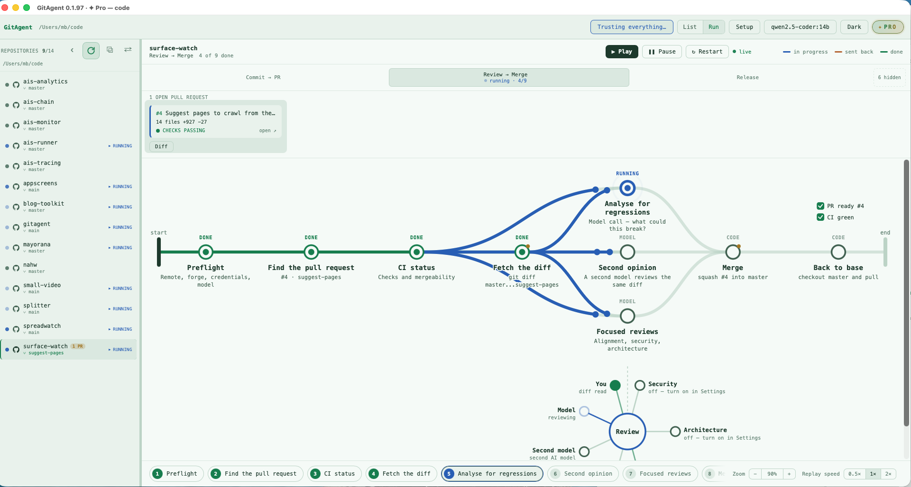

# GitAgent



An agentic graph for commit and deploy workflows. Desktop app, Dioxus, same
shape as the rest of the `ais-*` family.

Version one runs one hardcoded flow — turn a dirty working tree into an open
pull request — but the engine underneath it is not hardcoded, and that is the
point. Making the app generic means replacing `services/flow.rs`, not
rewriting anything else.

## The flow

```text
                                     ┌──> push ──────┐
  scan ──> draft_commit ──> commit ──>┤               ├──> open_pr
                                     └──> draft_pr ──┘
```

Six nodes. Three are deterministic shell work, two are model calls, and three
are gated on a human saying yes.

`draft_pr` waits for `commit`, so a run stopped at the commit approval never
spends a model call on a pull request description. It still runs beside
`push`: neither reads what the other writes, and `open_pr` waits for both.

| Node | Kind | Gated | Writes |
|---|---|---|---|
| `scan` | code | | `branch` `base` `stat` `diff` `commit_paths` `untracked` |
| `draft_commit` | model | | `branch_name` `commit_subject` `commit_body` |
| `commit` | code | ✓ | `work_branch` `commit_sha` |
| `draft_pr` | model | | `pr_title` `pr_body` |
| `push` | code | ✓ | `push_output` |
| `open_pr` | code | ✓ | `pr_url` |

## Approvals

Nothing touches git history or the remote without an explicit yes. A gated node
parks in `AwaitingApproval` and renders the exact commands it will run —
the real `git add -- …` path list, the real commit message, the real
`gh pr create` arguments. Reject blocks everything downstream of it and the run
ends cleanly.

Two consequences worth knowing:

* Only **tracked** changes are committed. Untracked files are listed in the
  scan output and deliberately left alone.
* The file list shown at the approval step is the exact argument list passed to
  `git add`. There is no `git add -A` anywhere in the codebase.

## Model providers

Local **ollama**, **api0** (Europe, China or the United States, on the
licence's AI credits) or a remote provider with a key of your own, switchable
in Settings.

* ollama sends an explicit `num_ctx` (default 16384). ollama's own default is
  4096 whatever the model claims to support, which truncates a real diff
  without telling you.
* Remote providers are OpenAI-compatible, so one client covers api0, OpenAI,
  Mistral, vLLM, LM Studio and OpenRouter — only the base URL and model change.
* Both run at `temperature: 0`. The same diff should produce the same commit
  message twice, or approving one is meaningless.

A provider's key is read from its environment variable at call time and is
never written to disk:

```bash
export OPENAI_API_KEY=sk-...
```

## Running it

```bash
cargo run
```

Add a repository, press **Start run**, approve or reject each gated step.

State lives in `~/Library/Application Support/gitagent/` — `repos.json` for the
registry, `settings.json` for the model config.

## Layout

```
src/services/graph.rs   engine: nodes, edges, state, scheduling. No IO.
src/services/flow.rs    the hardcoded flow + what each node does
src/services/llm.rs     ollama and remote APIs behind one complete_json()
src/services/git.rs     git and gh as subprocesses
src/services/store.rs   registry and settings on disk
src/screens/            welcome (repo list), run_screen (executor + layout)
src/components/         node_card, detail_pane, settings_panel
```

`graph.rs` knows nothing about git, models, or this flow in particular. That
separation is what the generic version depends on.

---

## Licence

Source-available under the [PolyForm Noncommercial License 1.0.0](LICENSE).

- **Free** for personal use, learning, research and hobby projects, and for
  charities, schools, universities and government institutions.
- **Commercial use requires a licence** — including a solo consultant using it
  on client work, and an employee using it at their job. That licence is
  [GitAgent Pro](https://mayorana.ch/en/apps/gitagent), bought on GitAgent's
  page; it also comes with monthly AI credits for the api0 model.

This is deliberately not an OSI-approved open source licence: the source is
public and readable, but companies using it for work buy GitAgent Pro.

The name, logo and icons are trademarks and are not covered by that licence —
fork it and rebrand it. See [TRADEMARK.md](TRADEMARK.md).
